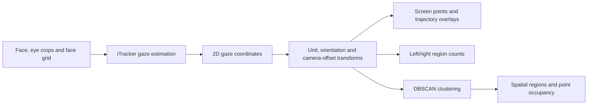
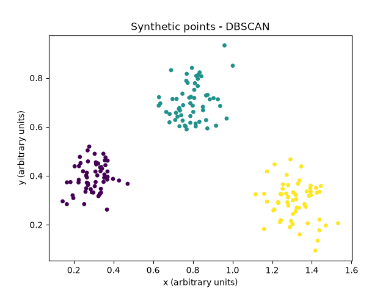

# FlaGaze · Visual Attention and Gaze Analysis

[中文](README.md)

When viewing the same visual content, where do gaze points land? Do they concentrate in one region, and how are they distributed between the left and right sides? FlaGaze originated as a gaze-analysis prototype for exploring visual attention in an ASD-related research context. Its focus is turning gaze coordinates into spatial features that can be inspected and compared.

The prototype explores a path from video and gaze estimation to screen mapping, trajectory overlays, region counts and clustering. The runnable repository focuses on coordinate transforms and DBSCAN, with a deterministic synthetic example. It is a research/programming prototype, not an ASD diagnostic or classification system.

## The research workflow



This diagram describes the research prototype. Its gaze-estimation stage follows GazeCapture / iTracker: face images, left/right eye images and a face-location grid feed a model that outputs two-dimensional coordinates. Downstream analysis works with those coordinates; group labels are not model predictions.

The exploratory scripts address three questions:

- **Which side receives more points?** Split the display at its midpoint and count valid samples on each side.
- **Where do points concentrate?** Use DBSCAN to identify dense groups and noise, then assess valid clusters with a silhouette score.
- **Do points fall within a reference region?** Construct a circle from a selected cluster's center and farthest-point distance, then measure the fraction of a second point set inside that circle.

Point counts are not automatically gaze duration. Converting counts to time requires uniform sampling and aligned frames/coordinates; timestamp-based analysis is needed for more precise durations. Cluster numbers do not mean “typical” or “atypical.”

## Runnable modules

| File | Input → processing → output |
| --- | --- |
| `gaze/coordinates.py` | An `N×2` array, physical dimensions in mm, screen pixels and orientation → unit/scale conversion → an `N×2` array. Camera mapping also takes an offset in mm. |
| `gaze/clusters.py` | Points, `eps` and `min_samples` → DBSCAN and valid-cluster scoring → labels and an optional silhouette score. Noise is labeled `-1`. |
| `gaze/demo.py` | Seed 42 and three synthetic centers → 60 samples per center and clustering → CSV, JSON and a scatter plot. |
| `tests/test_gaze.py` | Known coordinates and constructed point sets → orientation round trips, offset equations and cluster edge cases → five tests. |

`cm_to_pixels` and `pixels_to_cm` convert between physical and pixel units. Orientations 1 and 2 use portrait dimensions; 3 and 4 swap the physical width and height. `camera_to_screen` additionally applies orientation-dependent camera offsets. None of these functions reads video.

Image preprocessing, model inference, video overlays, left/right counting and circular-region comparisons belong to the research prototype workflow; **they are not provided by the current command-line example**. No clinical accuracy, sensitivity or classification performance is reported.

## A concrete run

Use Python 3.12 in a virtual environment:

```sh
python -m pip install -r requirements.txt
python -m gaze.demo
python -m unittest discover -s tests -v
```



The default output directory is `results/gaze/`:

| File | Contents |
| --- | --- |
| `synthetic_points.csv` | Columns `x,y`, containing 180 synthetic points in arbitrary units. |
| `clusters.png` | A scatter plot colored by cluster label. |
| `summary.json` | Point count, cluster count and silhouette score. The current seeded example produces three clusters and a score of approximately 0.7782. |

Colors represent clusters, not participant groups or diagnostic labels. The silhouette score describes separation within this example, not recognition accuracy. An all-noise or single-cluster result returns `None` when scoring is undefined.

A coordinate conversion example:

```python
from gaze.coordinates import cm_to_pixels

points = [[1.0, 2.0]]
pixels = cm_to_pixels(points, device_mm=(60, 100), screen_px=(600, 1000), orientation=1)
print(pixels)  # [[100. 200.]]
```

The prototype's gaze-estimation stage references GazeCapture / iTracker. That model and method are not claimed as original work here. This repository concentrates on coordinate processing and the clustering demonstration.
