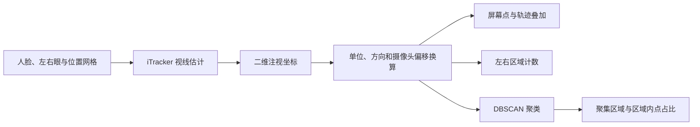
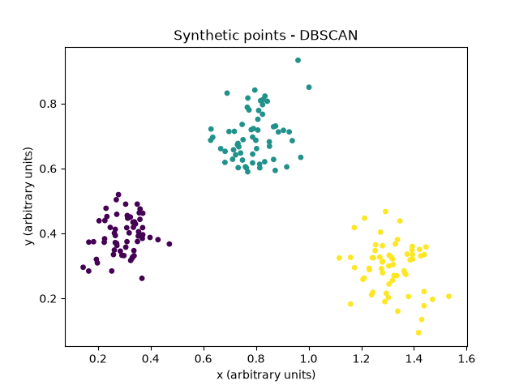

# FlaGaze · 视觉注意与眼动分析

[English](README.en.md)

观看同一段视觉内容时，注视点落在哪里、是否集中在某片区域、左右区域的分布有什么差别？FlaGaze 来自一个面向 ASD（自闭症谱系障碍）相关视觉注意研究的眼动分析原型，关注的是把注视坐标变成可以观察和比较的空间特征。

项目从视频与视线估计出发，探索屏幕映射、轨迹叠加、区域计数和聚类分析。当前可运行模块聚焦坐标换算与 DBSCAN，并提供固定种子的合成示例。这是研究与编程原型，不提供 ASD 诊断或分类结论。

## 从注视点到分析结果



这是研究原型的处理路线。视线估计沿用 GazeCapture / iTracker 的模型思路：人脸、左右眼图像和人脸位置网格共同输入，输出二维坐标。后续分析处理的是坐标，不把分组标签作为模型预测结果。

原型脚本探索过三类观察：

- **看向哪一侧：** 以画面中线划分左右区域，累计两侧的有效点数，比较空间分布。
- **点聚在哪里：** 用 DBSCAN 找出密集点簇，区分聚集区域与噪声点，并检查聚类的轮廓系数。
- **是否落在参考区域：** 用选定簇的中心和最远点距离形成圆形区域，再统计另一组点落入该区域的比例。

区域点数不直接等于注视时长。只有在采样间隔一致、帧与坐标对齐的前提下，才能通过点数与采样频率估计持续时间；更精确的时长分析需要时间戳。簇编号也没有“正常”或“异常”的含义。

## 仓库里可以运行什么

| 文件 | 输入 → 处理 → 输出 |
| --- | --- |
| `gaze/coordinates.py` | `N×2` 点、设备毫米尺寸、屏幕像素尺寸、方向 → 单位和尺度换算 → `N×2` 点数组；摄像头映射另接收毫米偏移量。 |
| `gaze/clusters.py` | `N×2` 点、`eps`、`min_samples` → DBSCAN 与有效簇评分 → 标签数组和可选轮廓系数。噪声标为 `-1`。 |
| `gaze/demo.py` | 随机种子 42、三个合成中心 → 每组生成 60 个点并聚类 → CSV、JSON 和散点图。 |
| `tests/test_gaze.py` | 已知坐标与构造点集 → 方向往返、偏移公式和聚类边界检查 → 5 项测试。 |

`cm_to_pixels` 和 `pixels_to_cm` 互为单位换算；方向 1、2 使用竖向尺寸，方向 3、4 交换物理宽高。`camera_to_screen` 再根据方向应用摄像头与屏幕之间的偏移。三个函数都不读取视频。

图像预处理、模型推理、视频叠加、左右区域统计和圆形区域比较属于研究原型流程，**不是当前命令行示例提供的功能**。目前不报告临床准确率、灵敏度或分类效果。

## 看一次实际输出

Python 3.12，在虚拟环境中安装依赖：

```sh
python -m pip install -r requirements.txt
python -m gaze.demo
python -m unittest discover -s tests -v
```



默认输出位于 `results/gaze/`：

| 文件 | 内容 |
| --- | --- |
| `synthetic_points.csv` | 两列 `x,y`，180 个合成点，使用任意单位。 |
| `clusters.png` | 按簇标签着色的散点图。 |
| `summary.json` | 点数、簇数及轮廓系数；当前固定种子示例为 3 个簇，系数约 0.7782。 |

图中颜色仅表示不同簇，不对应人群或诊断标签。轮廓系数反映这组点的聚类分离程度，不是识别准确率。全噪声、单簇等不满足评分条件时，模块返回 `None`。

坐标函数的调用示例：

```python
from gaze.coordinates import cm_to_pixels

points = [[1.0, 2.0]]
pixels = cm_to_pixels(points, device_mm=(60, 100), screen_px=(600, 1000), orientation=1)
print(pixels)  # [[100. 200.]]
```

研究原型的视线估计部分参考 GazeCapture / iTracker；模型与方法不作为本项目的原创成果。当前仓库围绕坐标处理和聚类演示展开。
